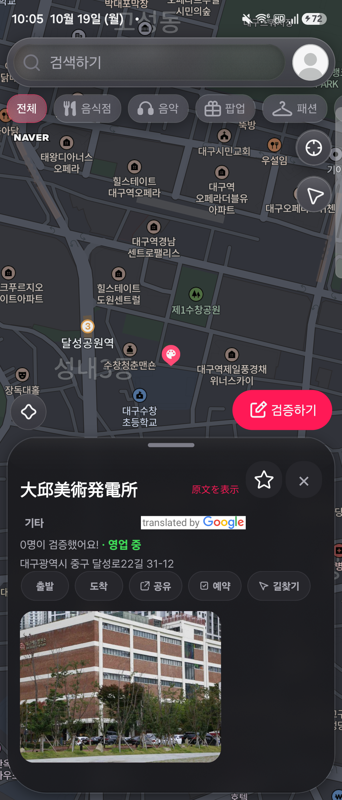

# 장소명 직접 전환 UI

2026-10-19 후속 요청에 따라 장소명 아래의 별도 번역 결과 영역과 상시 설정 버튼을 제거했다.

- 장소명 옆의 작은 버튼 하나로 원문 제목과 번역 제목을 전환한다.
- 기본 대상 언어는 프로필 국가에서 추천하고, 기존 수동 선택이 있으면 유지한다. 국가를 언어 코드로 그대로 사용하지 않는다. 다언어 국가/국가 누락은 같은 버튼으로 언어 선택을 연다.
- 언어 변경 및 모델 관리는 같은 버튼을 길게 누르거나 접근성 longpress 동작으로 연다.
- 제목은 최대 두 줄이며 원문/번역문 전환 때 행 높이를 유지한다. 원본 서버 데이터, API 계약, 공유/길찾기 등의 원문 기반 데이터는 변경하지 않는다.
- 번역 제목을 탭해 상세로 이동하는 동작과 번역 전환 버튼을 분리했다. 번역을 눌러도 상세로 이동하지 않는다.
- 공식 출처 배지만 제목 인접 영역에 표시한다. 원문과 번역문을 두 개의 본문 영역으로 표시하지 않는다.
- 다운로드 완료 후 자동 번역하지 않는 정책, 요청 중복 방지, 모델 관리, 캐시 및 늦은 응답 방지는 유지했다.

## Android 실기기

실제 서버 장소 `id 70128`:

1. 원문 제목: `대구예술발전소`, 작은 `翻訳` 버튼 하나.
2. 버튼 터치 후 같은 제목 위치: `大邱美術発電所`, 같은 버튼은 `原文を表示`로 전환.
3. 다시 터치해 원문 제목 복원 확인.
4. 사진 영역 bounds는 두 상태 모두 `[63,1925][698,2403]`로 동일. 이전의 별도 `오프라인 번역 가능` 본문 행도 없음.
5. AI·검증하기 버튼과 시트의 사진 클리핑은 유지됨.

이 실기기 확인은 UI 교체/토글 검증이다. 실제 모델 다운로드·인터넷 차단·재실행 검증은 [이전 기록](402-offline-place-translation-android.md)에 구분해 남겼다. 이번 UI 변경에서 iOS 실기기 검증은 수행하지 않았다.

## 코드 검증

- 장소 시트 + 번역 관련 Jest 63개 통과.
- 타입 검사 및 V2 경계 검사 통과.
- 전체 회귀 테스트 결과는 최종 작업 보고를 참고.
- V1 dependency delta: none. 커밋·푸시하지 않음.

## 출처 배지 배경 보정

후속 요청에 따라 배지 컨테이너의 흰 배경을 제거했다. 다크 테마는 공식 `white-short` 투명 PNG, 라이트 테마는 공식 `color-short` 투명 PNG를 사용한다. Android 다크 테마 실기기에서 확인했으며 타입 검사·V2 검사·번역 테스트 12개가 통과했다. [최신 배지 화면](402-transparent-translation-badge.png)
