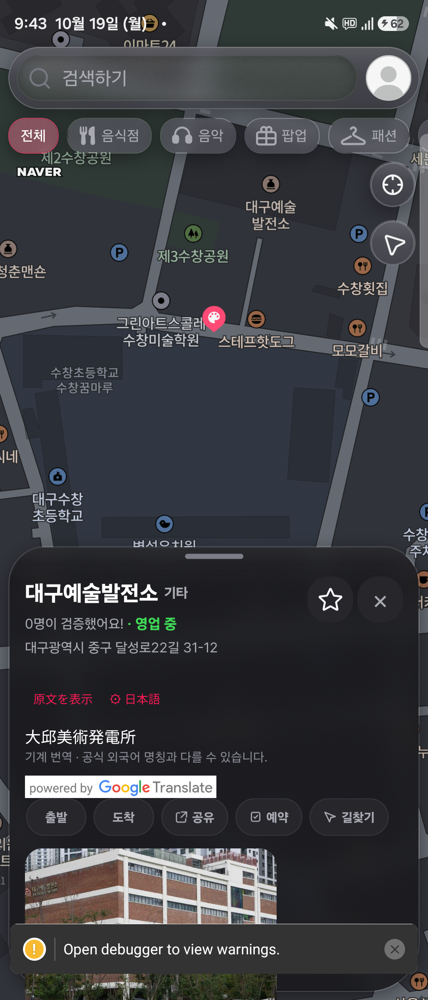
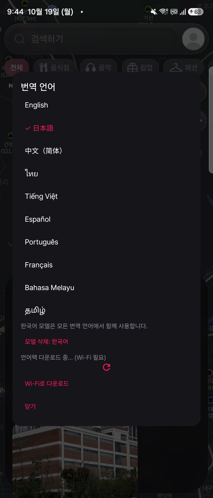

# 다운로드형 장소명 번역 Android 실기기 검증

> 이 문서의 별도 번역문 UI는 초기 검증 기록입니다. 최신 UI는 [장소명 직접 전환 검증](402-inline-place-name-translation.md)을 참고하세요.

2026-10-19, SM-F966N / Android 16 (API 36). 작업 브랜치의 Debug APK와 같은 체크아웃의 Metro 8092 사용. 실제 서버 모드이며 번역 SDK는 실제 ML Kit다. 모의 번역 응답은 사용하지 않았다.

## 확인한 흐름

1. 네이티브 설치 목록은 처음에 내장 `en`만 반환했다.
2. 실제 앱의 번역 서비스에서 `download('ja')`를 명시적으로 실행했다. 모델 다운로드와 문장 번역은 별도 작업으로 실행했다. 완료 후 네이티브 목록은 `ko`, `ja`, `en`이었다. 최초 다운로드 조작은 React Native 검사 연결을 통해 서비스로 실행했으며 UI 다운로드 버튼 전체 흐름의 실기기 성공으로 간주하지 않는다.
3. 인증된 실제 `/places` 응답에서 `id: 70129`, `name: 대구약령시한의약박물관`을 받았다. 응답의 별도 `englishName`을 번역 결과로 대체하지 않았다.
4. 기기의 Wi-Fi·모바일 데이터를 모두 껐다. Android 연결 상태는 `Active default network: none`, 앱의 실제 외부 서버 fetch는 `TypeError: Network request failed`였다. USB는 Metro/검사용 지정 포트 연결만 유지했다.
5. 이 상태에서 실제 번역 서비스가 해당 원문을 일본어 `大邱医学博物館`으로 처음 번역했다. 기존 번역 캐시는 없었다.
6. 네트워크를 원복한 뒤 앱을 force-stop하고 다시 실행했다. 설치 모델 `ko`, `ja`, `en`과 계정별 수동 대상 언어 `日本語`가 유지됐다.
7. 실제 서버 장소 `id: 70128`, `대구예술발전소`를 딥링크로 열었다. 네트워크를 다시 끄고 기본 인터넷 네트워크가 없음을 확인했다.
8. 실제 화면의 **翻訳 · Google** 버튼을 터치해 `大邱美術発電所` 결과가 표시되는 것을 확인했다. 재실행 후 이 원문의 첫 번역이며 검사 연결로 결과를 주입하지 않았다. 원문 제목, 기계 번역 안내, 공식 출처 배지가 함께 표시됐다.
9. 실제 **原文を表示** 버튼으로 번역문을 숨기고 원문 제목이 유지됨을 확인했다. 다시 번역 버튼으로 결과가 복원됐다. 제목과 액션 행의 화면 좌표는 전환 전후 동일했다.
10. Wi-Fi·모바일 데이터를 검증 전의 켜짐 상태(`1`, `1`)로 복원했다.
11. 실제 설정 화면에서 일본어 모델을 삭제했다. 삭제 후 일본어 모델 삭제 항목이 사라지고 `필요한 모델: 日本語 · 예상 용량: ≈30 MB` 안내가 표시됐다. 한국어 공용 모델은 유지됐다.
12. 실제 **Wi-Fi로 다운로드** 버튼을 눌렀다. 다운로드 진행 표시와 busy/disabled 상태를 캡처했다. 완료 후 `오프라인 번역 가능` 및 일본어 모델 삭제 항목이 다시 나타났다.
13. 설정 창을 닫아 다운로드만으로 자동 번역되지 않았음을 확인했다. 원문 제목, `翻訳 · Google` 버튼과 `오프라인 번역 가능` 안내가 표시되고 이전 번역문은 없었다. 기기에는 한국어·일본어 모델과 일본어 선택을 남겼다.

## 발견해 수정한 문제

네트워크가 끊기면 장소 정보 재조회가 실패하면서 전체 오류 화면이 로드된 카드 앞에 추가돼 번역 버튼이 화면 아래로 밀렸다. 로드된 `selectedPlace`가 있으면 카드를 유지하고, 데이터가 전혀 없을 때만 전체 오류 화면을 표시하도록 수정했다. 관련 Jest 회귀 테스트를 추가했다.

검증 도중 기존 세션 갱신 요청이 401로 실패해 사용자가 직접 재로그인했다. 인증 코드는 변경하지 않았다.

## 검증의 한계

- 위 두 결과는 공식 외국어 명칭 검증이 아니다. 특히 `발전소`가 문자 그대로 번역되는 등 고유명사 품질 제약이 드러난다. 원문과 기계 번역 구분이 필요하다.
- Android 네이티브 다운로드, 오프라인 실제 추론, 앱 재실행 후 모델 유지, 실제 장소 시트 번역/원문 토글을 확인했다. UI의 모델 삭제→예상 용량 안내→다운로드 승인→진행→완료→자동 번역 없음까지 확인했다. 다운로드 실패 복구와 모든 언어 조합은 미검증이다.
- iOS는 네이티브 빌드 통과까지만 확인했다. iOS 실기기 모델 다운로드·오프라인 번역은 미검증이다.
- 실기기는 다크 테마/폴더블 외부 디스플레이였다. 작은 화면, 큰 글꼴, 라이트 테마의 실기기 검증은 남아 있다.

## 수정 후 코드 검증

- `npm run typecheck`: 통과.
- `npm run check:v2`: 통과 (76개 경계 테스트).
- 장소 시트 51개 및 번역 테스트 11개: 62개 통과. 기존 비동기 act 경고는 남아 있다.
- 이전 전체 `test:regression` 382개 통과. 실기기에서 발견한 수정은 장소 시트에 국한되며 수정 후 해당 관련 테스트를 재실행했다.
